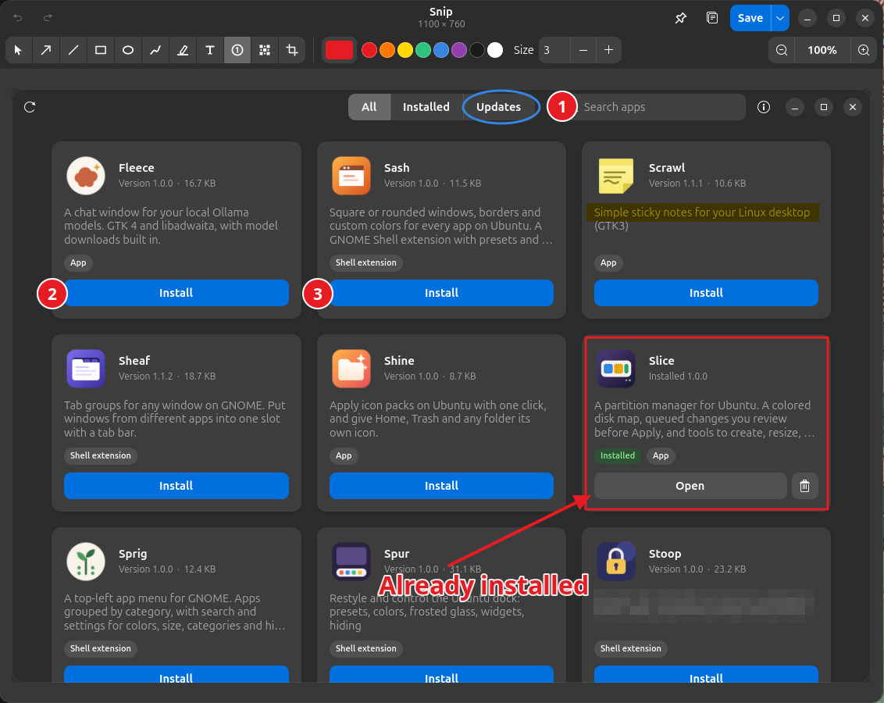
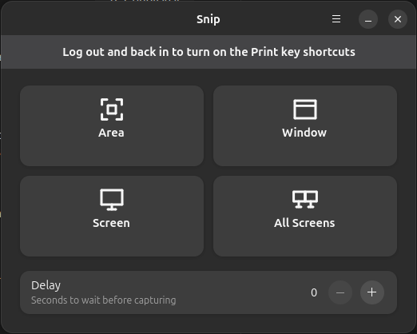
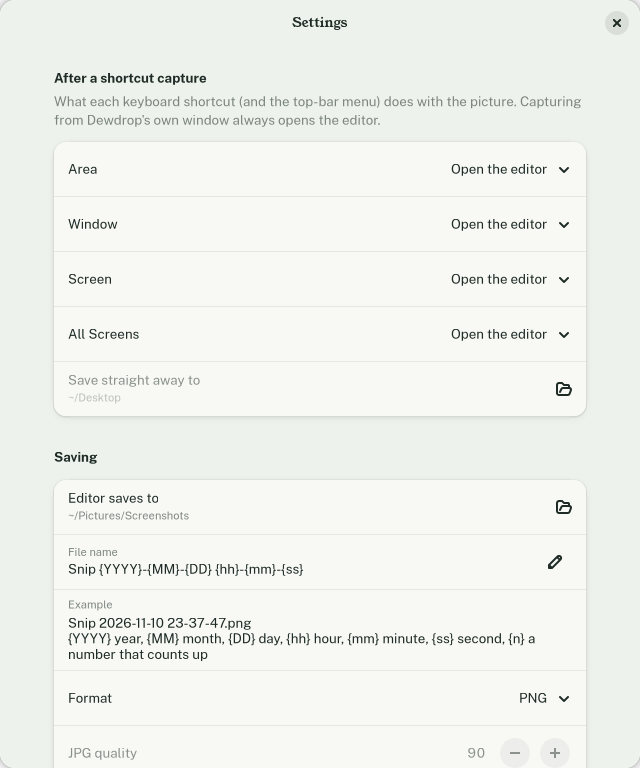

# Dewdrop

*Formerly Snip. Part of the Sedge family of webhookstudios apps.*

Screenshots with markup for Ubuntu. Press Print, drag out an area or click a window, then add arrows, boxes, numbered steps and blur before you copy, save or pin the result on screen.



## What it does

- **Captures an area, a window, one screen or all screens**, from the Print key or from Dewdrop's own window. Area capture freezes the screen, so open menus and tooltips stay put. Hovering highlights the window under the pointer; click it to take just that window, or drag for any area.
- **Window capture takes the whole window** even when other windows cover part of it, without the drop shadow.
- **An editor with 11 tools:** select and move, arrow, line, rectangle, ellipse, pen, highlighter, text, numbered steps that count up by themselves (1, 2, 3…), blur or pixelate, and crop.
- **Color and width for every tool**, with quick swatches and a full color picker. Each tool remembers its own color and size. Select a shape to recolor, resize, move or delete it.
- **Undo and redo** for everything, including crops.
- **Copy** to the clipboard, **save** as PNG or JPG to a default folder with a file name pattern, or **Save As** anywhere.
- **Pin** the result on screen: a borderless picture that stays on top of other windows. It reopens where you captured it, so it lines up with what it shows.
- **A top-bar menu** with the same captures, and **Open Last Capture**.
- **Quick shortcuts**: set any shortcut to save straight to your Desktop (or copy, or pin) without opening the editor.



## Shortcuts

| Key | Captures |
|---|---|
| `Print` | An area you drag out, or a window you click |
| `Alt+Print` | A window |
| `Shift+Print` | The screen under the pointer |
| `Ctrl+Print` | All screens in one picture |

These are GNOME's own screenshot keys. While Dewdrop's shell extension is on, it takes them over and gives them back when it is turned off. Change them, or keep GNOME's screenshot tool on those keys, in Dewdrop's **Preferences**.

In the editor:

| To do this | Press |
|---|---|
| Pick a tool | `V` select, `A` arrow, `L` line, `R` rectangle, `E` ellipse, `F` pen, `H` highlighter, `T` text, `I` numbered step, `B` blur, `C` crop |
| Straight lines, squares and circles | Hold `Shift` while dragging |
| Edit a text | Double-click it |
| Delete the selected shape | `Delete` |
| Nudge the selected shape | Arrow keys (`Shift` for 10 px) |
| Apply a crop | `Enter` or double-click |
| Undo / redo | `Ctrl+Z` / `Ctrl+Shift+Z` |
| Copy / save / save as / pin | `Ctrl+C` / `Ctrl+S` / `Ctrl+Shift+S` / `Ctrl+P` |
| Zoom | `Ctrl+scroll`, `Ctrl++`, `Ctrl+−`, `Ctrl+0` fit, `Ctrl+1` actual size |

A pinned picture: drag to move it, scroll to zoom, `Ctrl+scroll` to fade it, double-click or `Esc` to close it. Right-click for copy, save, edit, zoom and opacity.

## Settings



- **After a shortcut capture**, chosen separately for each shortcut: open the editor (default), **save straight away** with no window at all, copy to the clipboard, or pin on screen. For example, set **Screen** to *Save straight away* and Shift+Print saves the display under the pointer to your Desktop. This applies to the keyboard shortcuts, the top-bar menu, the dock menu and `dewdrop --area` and the like. The buttons in Dewdrop's own window always open the editor, so you can adjust the picture.
- **Save straight away to**: where those quick saves go (default `~/Desktop`).
- **Folder** for saved screenshots (default `~/Pictures/Screenshots`) and the **file name** pattern: `{YYYY}` `{MM}` `{DD}` `{hh}` `{mm}` `{ss}` for the date and time, `{n}` for a number that counts up.
- **Format** PNG or JPG, and JPG quality.

## Command line

```
dewdrop                 open Dewdrop
dewdrop --area          capture an area or a window you click
dewdrop --window        capture a window
dewdrop --screen        capture one screen
dewdrop --all           capture all screens
dewdrop --delay 5 ...   wait 5 seconds first
dewdrop picture.png     open a picture in the editor
dewdrop --last          open the last capture again
dewdrop --pin picture.png
```

Right-click Dewdrop in the dock or apps grid for **Capture Area**, **Window**, **Screen** and **All Screens**.

## Requirements

Ubuntu 26.04 with GNOME Shell 50 on Wayland. Tested on Ubuntu 26.04 with GNOME Shell 50.1 and two 2560 × 1440 monitors.

## Install

### With the deb package (recommended)

Download `dewdrop_1.1.0_all.deb` from the [latest release](https://github.com/webhookstudios/dewdrop/releases/latest), then install it:

```bash
sudo apt install ./dewdrop_1.1.0_all.deb
```

Log out and back in, open **Dewdrop** from the apps menu, and click **Turn On** in its banner to switch on the Print key shortcuts.

To remove it:

```bash
sudo apt remove dewdrop
```

### From source, for the current user only

```bash
git clone https://github.com/webhookstudios/dewdrop.git
cd dewdrop
./install.sh
```

This installs the app to `~/.local/share/dewdrop`, adds `dewdrop` to `~/.local/bin`, and installs and turns on the shell extension. Log out and back in once so GNOME loads the extension. Remove it all with `./install.sh --uninstall`.

To build the packages yourself, run `./build-deb.sh` (writes `dist/dewdrop_<version>_all.deb`) and `./pack.sh` (writes the extension zip).

## How it works

Wayland does not let ordinary apps read the screen or find out where windows are, so Dewdrop comes in two parts:

- **A small GNOME Shell extension** does the capturing. GNOME Shell draws the screen, so it can freeze it, list the windows, read one window's picture even where it is covered, and register the Print keys. It shows the area and window picker, saves the picture in `~/.cache/dewdrop/captures`, and opens it in Dewdrop. The app reaches the same capture over D-Bus (`io.github.webhookstudios.Dewdrop.Shell`).
- **The Dewdrop app** (Python, GTK 4 and libadwaita) is the editor, the start window and the preferences.

**Without the extension** (before the first logout, or if it is turned off), Dewdrop's buttons still work through the desktop's screenshot portal: screen and all-screens captures are silent, area capture uses Dewdrop's own full-screen picker, and window capture opens GNOME's screenshot window, where you pick the window. There are no Print key shortcuts in this mode.

**Pins** are like [Leaf](https://github.com/webhookstudios/leaf)'s notes: Wayland does not let an app keep its window above others or choose where it goes, so pins run through XWayland with GTK 3, which can do both.

**Copying** goes to GNOME Shell's clipboard when the extension is on, so the picture stays there after the editor closes. Without the extension, a small background helper keeps the copy available until you copy something else.

Settings live in `~/.config/dewdrop/settings.json` and the shortcuts in the extension's GSettings (`org.gnome.shell.extensions.dewdrop`). Captures in `~/.cache/dewdrop` are deleted after two days.

## Limits

- The shell extension is for GNOME 50. Each GNOME release usually needs a small update.
- The mouse pointer is not included in captures.
- Without the extension, the fallback area picker works within one monitor at a time.
- An area that spans monitors with different scaling is captured at the highest scale.
- With the extension on, older apps that run through XWayland may not be able to paste a large copied screenshot. GTK 4, GNOME and other Wayland apps paste it normally.

## License

GPL-2.0-or-later
